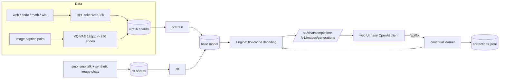

# Architecture

## One token stream for everything

`tokens.py` fixes the ID layout (never renumber; shards depend on it):

| IDs | Meaning |
|---|---|
| 0 - 32767 | text (byte-level BPE) |
| 32768 - 40959 | image codes (VQ-VAE codebook, 8192) |
| 40960 - 45055 | audio codes (reserved) |
| 45056 - 45119 | specials: `<|endoftext|>`, `<|img|>`, `<|/img|>`, `<|aud|>`, `<|/aud|>`, `<|pad|>`, `<|system|>`, `<|user|>`, `<|assistant|>`, `<|end|>` |

An image is `<|img|>` + 256 codes + `<|/img|>`. Because text and image tokens share one model, training on
`caption <|img|>...` teaches text-to-image and `<|img|>... caption` teaches image-to-text.

## Model

`model/gpt.py`: GPT-2-style decoder, 12 layers, 12 heads, width 768, learned positions, tied embeddings, flash attention
(`scaled_dot_product_attention`), context 1024, ~124M parameters. `prefill` + `decode_step` implement KV-cache decoding.

## Chat format

`chat_template.py`: `<|user|> text <|end|> <|assistant|> reply <|end|>`. The loss mask is 1 only on assistant content and
its closing `<|end|>`, so the model learns to answer and to stop. Messages may contain image parts.

## Image generation

During a chat reply the engine masks logits per mode: text mode allows text + `<|end|>` + `<|img|>`; after `<|img|>` only
image codes are allowed until 256 are produced, then `<|/img|>` is fed and text mode resumes. `/v1/images/generations`
forces image mode directly. Codes are turned into pixels by the VQ-VAE decoder.

## Continual learning

1. `/api/fix` stores `{context, reply}` in `corrections.jsonl` (the permanent record).
2. A short fine-tune runs on the new correction + older ones + replayed SFT/pretraining data (anti-forgetting), loss only on
   the corrected reply. The result is saved atomically to `artifacts/live/live.pt`.
3. At chat time the most similar past corrections (TF-IDF over their questions) are inserted as earlier turns, so a
   corrected fact works immediately even if the weights haven't absorbed it.
4. `scratchgpt rebuild` re-applies every correction to the *current* base model after pretraining has moved on.

Checkpoint priority when serving: live > sft > pretrained.

## Crash safety (`safeio.py`)

Writes go to `<file>.tmp`, are fsync'ed, then renamed over the target (atomic); the previous good version is kept as
`<file>.prev` and loaders fall back to it. Data preparation records each dataset's exact stream position (`state_dict`)
together with the shard it belongs to, so shards and state always agree. `tests/test_prepare_pretrain.py` simulates
Ctrl+C, a power cut, a corrupted state file and a lost state file, and asserts the final data equals an uninterrupted run.
